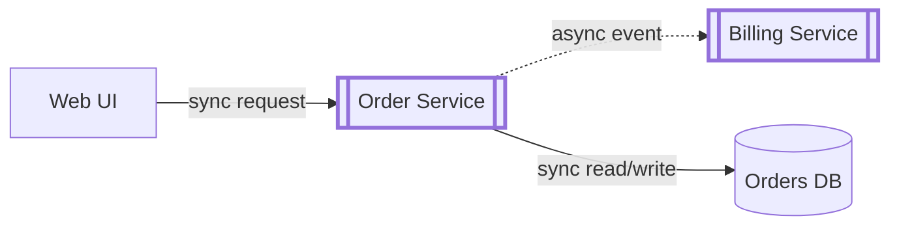

# Tools, Fidelity and Semantic Layers

## Contents

- Fidelity follows design maturity
- Irrational Artifact Attachment
- Ephemeral media: whiteboard versus tablet
- Baseline tool features
- Layers with meaning
- Translating these ideas to diagrams-as-code
- Pitfalls

## Fidelity follows design maturity

Modern diagramming tools are capable, and an architect should know one of them thoroughly. The chapter's warning is about timing: do not reach for the polished tool too early. While the design is still moving, use throwaway artifacts (sticky notes, index cards, whiteboard sketches, quick tablet drawings). Move to a carefully produced diagram only after the team has iterated enough that the structure has settled.

The chapter's closing argument reinforces this with history: older heavyweight CASE tools forced architects to build elaborate models full of details that were pure noise for the question at hand. The authors prefer lightweight tooling and rough artifacts, particularly early on.

Decision rule:

| Design state | Appropriate fidelity |
|---|---|
| Exploring options, several candidate topologies | Sketches, cards, tablet doodles; expect to discard most |
| Converging, one topology under refinement | Quick digital drawings, still cheap to redo |
| Settled, needed for approval, onboarding or long-lived docs | Polished diagram in the team's chosen tool, with stencils and layers |

## Irrational Artifact Attachment

An antipattern: the more time someone sinks into producing an artifact, the more irrationally attached to it they become, and the harder it is for them to accept that it is wrong. A diagram that took four hours is defended harder than one that took two, regardless of merit.

Agile practice counters this by producing artifacts just in time with minimal ceremony; cheap media make discarding a wrong idea painless, so the right shape can emerge through revision and conversation.

How to spot it: an architect resisting a structural change because "the diagram is already done"; polishing visuals before the design has been challenged; reluctance to sketch alternatives next to the "official" picture.

Countermeasures: time-box early diagrams; produce at least two alternative sketches before polishing one; keep the polished version out of reach until a review has stressed the design; when you notice defensiveness, ask whether the objection is to the design or to redoing the drawing. The chapter's final caution applies here: enjoy your diagrams, but never let fondness for them cost you objectivity.

## Ephemeral media: whiteboard versus tablet

The traditional throwaway artifact is a phone snapshot of a whiteboard. The authors note many architects now draw on a tablet mirrored to a projector, which wins on four counts:

1. The canvas never runs out, so the team can keep every drawing.
2. "What if" variants can be duplicated and altered without erasing the original.
3. Output is born digital, with no glare or skew from photographing a board.
4. Digital images suit remote and distributed collaboration.

## Baseline tool features

The authors used OmniGraffle for the book's originals but do not endorse a particular product. Whatever the tool, look for at least:

- **Layers**: group items logically and toggle their visibility. Lets one master diagram serve several audiences (hide detail when not discussing it) and supports build-up sequences in presentations.
- **Stencils or templates**: a reusable library of shapes, including composites. An organization-wide stencil set for recurring patterns gives diagrams a consistent look and makes new ones faster to draw.
- **Magnets**: snap points on shapes where connectors attach automatically, keeping lines aligned; better tools let you add or define your own.
- **Basics**: lines, shapes, color, and export to many formats.

## Layers with meaning

The authors prefer to use layers semantically rather than decoratively, so each layer adds a distinct kind of meaning:

1. **Base layer: architectural topology.** Containers, databases, brokers, dependencies and other core structure, described in architectural terms (for example "synchronous call" or "asynchronous message"), never naming a specific protocol or product.
2. **Implementation layer.** The concrete choices: which database engine, which protocol, which broker product.
3. **Contextual overlay layers (optional, any number).** Domain-driven design bounded contexts, transaction scopes, team ownership, deployment regions, architecture quanta, or any other meta-information you want to contrast against the topology.

Benefit: the diagram is extensible. You can add a new analytical lens without redrawing the structure, and you can show the same topology to executives (base only) and to engineers (base plus implementation).

## Translating these ideas to diagrams-as-code

Agents often emit Mermaid, PlantUML or Structurizr DSL instead of using a drawing tool. Equivalents:

- Layers become separate views generated from one model (Structurizr views, or multiple Mermaid files sharing node IDs), or optional subgraphs you include per audience.
- Stencils become shared style definitions (Mermaid `classDef`, PlantUML includes such as C4-PlantUML, Structurizr themes) kept in one file the organization reuses.
- Magnets have no direct equivalent; prefer layout direction hints and fewer crossing edges.

Illustrative Mermaid sketch showing a base topology with sync and async edges:

Solid arrows are synchronous, dotted arrows asynchronous, the cylinder is a database, and every edge carries a label.

## Pitfalls

- Polishing before iterating (feeds artifact attachment).
- Mixing protocol names into the topology layer, which ties the architecture view to implementation choices.
- Using layers only for visual styling, losing the chance to overlay meaning.
- Every architect inventing private icons instead of building a shared stencil set.
