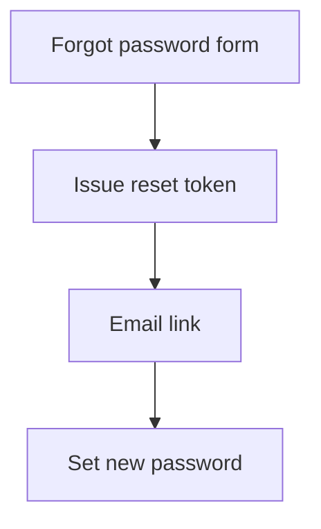
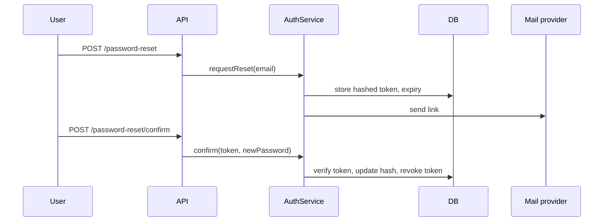

# Building Mental Models Incrementally

## Definition

A mental model is your internal picture of how the system behaves. It is built slice by slice through deliberate practice, never all at once.

## Rule 1: slice before you model

Trying to model a whole application is overwhelming and wasteful. Pick one slice:
- **By flow** (start from an entry point): for a subscription product, slices could be "trial sign-up issues a welcome credit", "renewal charges the stored card", "customer cancels and gets a prorated refund". Read the code for one flow end to end, then model it.
- **By feature** (if the code is packaged by feature): model one feature folder, including its controller, service, repository, entities and DTOs.

Choose whichever matches how you learn: some people anchor on business processes, others on code units.

## Rule 2: do not let tools or perfectionism block you

A pencil sketch is often enough. Visual polish is optional; correctness and usefulness are what matter.

## Choosing a visualization

| Question you are trying to answer | Diagram |
|---|---|
| What happens in what order, and where are the decisions? | Flowchart |
| What data exists and how do records relate? | Entity-relationship diagram |
| Which components talk to which, in what time order? | Sequence diagram |
| What are the big blocks and their dependencies? | Component diagram |
| How do related concepts and terms group together? | Mind map |

## Grow the diagram as understanding grows

Start with only the major steps, then add services, data stores and external calls once you have seen them in code. Text-based tools such as Mermaid keep diagrams diffable and easy to revise.

First pass (original example, password reset):

Later pass, after tracing the code:

AI assist: describe the flow you traced to an LLM and ask for Mermaid as a first draft, then correct it by hand against what the code really does. The draft is a starting point, not evidence.

## Rule 3: widen scope in a fixed order

1. One method by itself.
2. Its class plus direct collaborators.
3. A feature-level flow crossing several components.
4. Cross-cutting concerns last: security, transactions, caching, logging, error handling.

Skipping ahead (for example, studying the transaction setup before knowing any flow) causes cognitive overload.

## Keeping the model honest

- Validate each diagram with a teammate who knows the area; corrections are cheap now and expensive later.
- Treat the model as a living artifact. Systems evolve, and even veterans keep revising their understanding.
- Better models lead to better modification decisions: you see which callers, data and integrations a change will touch.

## Pitfalls

- Starting a whole-system diagram on day one.
- Spending hours on diagram tooling instead of understanding.
- Copying an AI-generated diagram into team docs without checking it against code.
- Jumping to cross-cutting concerns before any single flow is clear.
